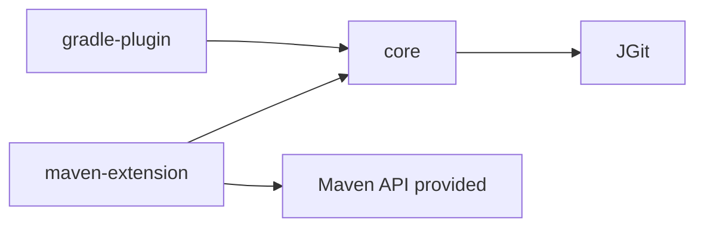

# Requirements

### Overview & Goals
Replace the single-module Maven build (`pom.xml`, packaging `maven-plugin`) with a Gradle 9.8.2 multi-module build with three modules:
- `git-versioning-core`: build-system-independent git version generation (JGit based).
- `git-versioning-maven-extension`: the Maven extension/plugin (model processor, mojo).
- `git-versioning-gradle-plugin`: Gradle plugin, left empty (builds, no implementation).

### Scope
In: Gradle wrapper 9.8.2, settings/build scripts (Kotlin DSL), source/test moves, Java 17, tests (unit + ITs), publishing metadata parity (POM info, sources/javadoc jars, signing), mise.toml and CI/doc updates.
Out: any Gradle plugin logic; behaviour changes to version computation; package renames.

### Functional Requirements
- `./gradlew build` succeeds on all modules; `./gradlew --version` reports 9.8.2.
- The Maven extension artifact still works as a Maven extension (contains `META-INF/maven/plugin.xml` and `META-INF/maven/extension.xml`/Sisu index as today) and existing ITs pass.
- Core has no dependency on Maven APIs.

# Technical Design

### Current Implementation
Single `pom.xml` (`fr.rozanc.maven:maven-git-versioning-extension:10.0.0-SNAPSHOT`, packaging maven-plugin, Java 17, JGit, Jackson XML, Maven 3.10.0 provided APIs, JUnit 6 BOM, surefire/failsafe, maven-dependency-plugin unpacking Maven distributions for `MavenCompatibilityIT`, `release` profile). Sources:
- `src/main/java/fr/rozanc/maven/gitversioning/commons/*` (GitUtil, GitSituation, GitDescription, GitRefType, TagComparator, Lazy, StringUtil) — only Maven coupling is `DefaultArtifactVersion` import (in one class).
- `src/main/java/fr/rozanc/maven/maven/gitversioning/*` (GitVersioningModelProcessor, GitVersioningMojo, MavenUtil, BuildProperties, Configuration, GitVersionDetails, GAV, LogStyle) and `src/main/resources/mavenBuild.properties`.
- Tests: `commons/*Test` (4) and maven package tests (BuildPropertiesTest, GAVTest, LogStyleTest, GitVersioningModelProcessorTest, ITs `GitVersioningExtensionIT`, `MavenCompatibilityIT`) plus `src/test/resources/testProjects/**`.

### Key Decisions
- Kotlin DSL (`*.gradle.kts`) with a version catalog `gradle/libs.versions.toml` replacing pom properties.
- Core coupling to Maven: replace `DefaultArtifactVersion` with a small own version parser (or `org.apache.maven:maven-artifact` as an `implementation` dep if behaviour parity is hard) — decide when inspecting the usage; prefer own code to keep core Maven-free.
- Maven plugin descriptor generation via the `io.github.f-bergmann...`/community plugin is unreliable; use `de.benediktritter.maven-plugin-development` plugin (supports Gradle 9 check at implementation time; fallback: run `maven-plugin-plugin` descriptor tool via a JavaExec task).
- Gradle plugin module uses `java-gradle-plugin` with no plugin declared yet (empty `src/main/java` placeholder).
- Keep Maven coordinates (group `fr.rozanc.maven`; artifactIds `git-versioning-core`, `git-versioning-maven-extension`, `git-versioning-gradle-plugin`) and publishing via `maven-publish` + `signing`; `release` profile becomes a property-guarded config.
- Integration tests: separate `integrationTest` source set/task in the extension module; the Maven-distribution download/unpack (dependency-plugin) becomes a Gradle task that resolves `org.apache.maven:apache-maven:<v>:bin@zip` configuration and unzips to `build/it-maven-distributions`, passed as a system property.

### File Structure
- `settings.gradle.kts`, root `build.gradle.kts` (shared conventions via `buildSrc` or `build-logic` convention plugin: Java 17 release, UTF-8, JUnit platform, POM metadata), `gradle.properties`, `gradle/libs.versions.toml`, `gradle/wrapper/*`, `gradlew(.bat)`.
- `git-versioning-core/build.gradle.kts` + `src/{main,test}/java/fr/rozanc/maven/gitversioning/commons/*` (git mv).
- `git-versioning-maven-extension/build.gradle.kts` + `src/main/java/fr/rozanc/maven/maven/gitversioning/*`, `src/main/resources/mavenBuild.properties` (version filtering via `processResources` expand), tests, `src/test/resources/testProjects`.
- `git-versioning-gradle-plugin/build.gradle.kts` (empty).
- Remove `pom.xml`, `mvnw*`, `.mvn`; update `mise.toml` (gradle 9.8.2), `.github/workflows`, `.github/dependabot.yml`, README build section, `.gitignore`.

### Dependency Graph

### Risks
- Maven plugin descriptor/extension metadata generation under Gradle; verify with IT.
- ITs invoke Maven against test projects using the built jar path/version; adjust system properties.
- `mavenBuild.properties` resource filtering (`${project.version}`) must be reproduced.
- Test resources referencing the project's own artifact coordinates in `.mvn/extensions.xml` need updating to the new artifactId.
- Gradle 9.8.2 availability: verify the wrapper can download it.

# Testing

### Validation Approach
- `./gradlew --version` shows 9.8.2; `./gradlew build` green for all modules.
- Run unit tests per module; run `integrationTest` in the extension module (both `GitVersioningExtensionIT` and `MavenCompatibilityIT`).
- Inspect the extension jar for `META-INF/maven/plugin.xml` and resources; check core dependency tree has no `org.apache.maven`.
- `./gradlew publishToMavenLocal` produces three artifacts with POM metadata.

# Delivery Steps

### ✓ Step 1: Bootstrap Gradle 9.8.2 multi-module build and split sources
Repo builds with Gradle 9.8.2 as three modules with sources and unit tests relocated.

- Generate wrapper 9.8.2; add `settings.gradle.kts`, root build, version catalog, convention plugin (Java 17, UTF-8, JUnit 6).
- `git mv` commons main/test into `git-versioning-core`; remove Maven API usage (`DefaultArtifactVersion`) from core.
- `git mv` maven package, resources and tests into `git-versioning-maven-extension`, depending on core.
- Create empty `git-versioning-gradle-plugin` module with `java-gradle-plugin`.
- Run unit tests in core and extension.

### ✓ Step 2: Make the Maven extension module a working Maven plugin/extension
Extension jar is functionally equivalent to the old Maven artifact.

- Configure plugin descriptor generation (goal prefix, extension metadata) and resource filtering for `mavenBuild.properties`.
- Port the Maven-distribution unpack task and `integrationTest` source set/task; update test project extension coordinates.
- Run `GitVersioningExtensionIT` and `MavenCompatibilityIT`.

### ✓ Step 3: Port publishing, CI and docs; remove Maven build files
No Maven build files remain and release/CI/docs use Gradle.

- Configure `maven-publish`, sources/javadoc jars, POM metadata, signing/Central publishing guarded by a release property.
- Update `mise.toml`, GitHub workflows, dependabot (gradle ecosystem), README and CHANGELOG, `.gitignore`.
- Delete `pom.xml`, `mvnw*`, `.mvn`; run full `./gradlew build` and `publishToMavenLocal`.